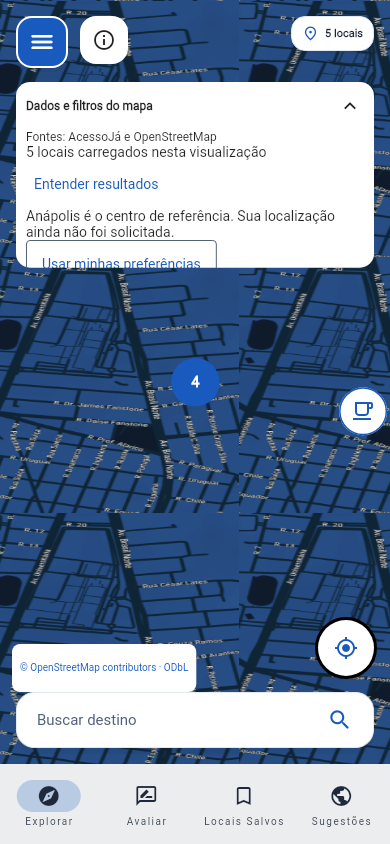
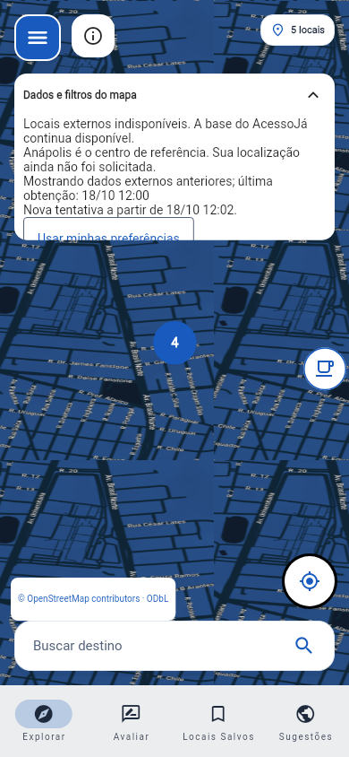
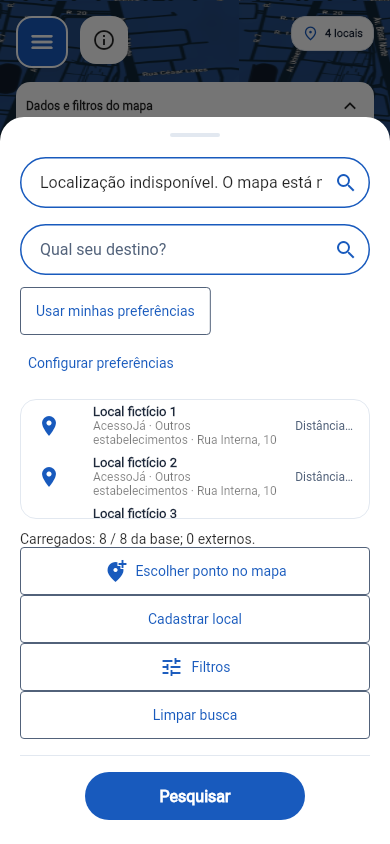

# AcessoJá — correção do mapa após os Cards 28–33

Entrega validada em 18/10/2026, fuso America/Sao_Paulo (UTC−03:00). Datas das
capturas são de relógio controlado da fixture, e não de chamadas reais ao provedor.
Este pacote contém somente arquivos criados ou alterados nesta correção.

## 1. Base efetiva e aplicação

A cópia recebida foi recuperada dos ZIPs fornecidos: aplicação principal,
Cards 24–27 e, por último, `acessoja_cards_28_33(1).zip`. SHA-256 deste último:
`183960dbd1b4058526792f4602266d4f774c6321c48f892e37b442a6f5d55ace`.
O documento histórico dos Cards 24–27 foi recuperado por consulta de leitura.
A referência remota `develop` consultada apontava para
`1e6d59a0d4f3fb9f3d5be5e11070f145bfe339f0`; a consulta da branch citada
`feature/cards-28-33-mapa-busca-rotas` retornou 404.

O diretório de trabalho não contém `.git`. Portanto, **branch/HEAD e alterações
locais atuais do PC 1 não foram verificados**. A referência histórica não é
apresentada como HEAD desse computador. Nenhuma escrita de Git, PR, publicação,
mudança de banco pessoal, mensagem ou alteração de Trello foi executada.
O estado inicial foi registrado por hash antes das alterações. Cada arquivo
alterado conserva o conteúdo preexistente dos Cards, além desta correção.

Versões verificadas: Python 3.12.14, Django 5.1.3, DRF 3.17.2, requests 2.34.2,
Flutter 3.47.4, Dart 3.13.3. Não foram atualizados frameworks nem o lock do Flutter.
Redis é uma dependência opcional nova para o modo compartilhado: cliente 8.1.0 e
servidor isolado 6.2.14 foram usados na integração local. O CI adicionado usa Redis 7.

Antes de aplicar no PC 1:

1. Guarde os arquivos atuais e mantenha seu `.env` e banco existentes. Com o app
   parado, faça o backup do banco pelo procedimento adequado ao SQLite/PostgreSQL.
2. Extraia o ZIP primeiro em uma pasta de revisão. Compare os caminhos e hashes
   anteriores em `MANIFEST_CORRECAO_MAPA_28_33.json` com seu checkout.
3. Se um arquivo tiver alterações locais posteriores, faça a composição manual;
   não substitua essas alterações cegamente. O ZIP não conhece o trabalho atual do PC 1.
4. Copie apenas os arquivos revisados para os mesmos caminhos relativos na raiz
   de `acessoja-app`. Não há pasta extra envolvendo o projeto dentro do ZIP.
5. Atualize somente as variáveis necessárias no `.env` existente. Não o substitua
   pelo exemplo. Não há nova migration nesta correção nem backfill geográfico.

O delta exige a implementação dos Cards 24–33 já presente. Ele não instala esses
Cards em um checkout antigo. Não há arquivos removidos ou renomeados.
Para reverter somente esta correção, pare os processos, restaure dos seus backups
os arquivos que já existiam e remova apenas os que o manifesto identifica como
novos. Preserve alterações posteriores por composição. Não use reset/clean e não
reverta migrations dos Cards para desfazer este delta. As chaves novas de cache
podem expirar naturalmente; não limpe indiscriminadamente o cache de produção.

## 2. Auditoria e causas

| Caso | Evidência disponível e causa | Correção / evidência |
| --- | --- | --- |
| Atualização externa apaga dados | Confirmado no código inicial: `_fetchExternalPlaces` esvaziava a lista antes da resposta. A finalização antiga podia alterar loading atual. | Snapshot por área, consulta e sessão; refresh preserva dados compatíveis. Testes de falha, vazio e respostas A→B. |
| Área restritiva oculta | Confirmado: `_internalBounds` persistia; a montagem da consulta retirava a área enquanto havia texto e voltava a aplicá-la ao limpar texto. | Área permanece explícita junto do termo; ação própria para removê-la. Teste verifica as URLs efetivamente enviadas. |
| Retry-After e status indistintos | Confirmado: espera local substituía o cabeçalho do provedor e alguns status viravam erro genérico. | Envelope compatível, origem do status/espera, segundos e três formatos de data HTTP; prazos longos respeitados. |
| Coordenação local tratada como global | Confirmado: o cache padrão era LocMemCache, por processo. | Redis usa Lua, tempo do servidor, lease com proprietário e liberação condicional. Quatro processos reais disputam uma única permissão no teste. |
| Custo da consulta geral | Confirmado: repetição de seletores nwr por valor do catálogo. | União geral reduzida a quatro seletores espaciais, mantendo cobertura do catálogo e limites anteriores. |
| Contagens pouco claras | Confirmado: dados carregados, georreferenciados e posição da câmera não tinham síntese equivalente. | Contagem por viewport atualizada sem buscar externamente; detalhes em expansão, sem confundir cluster com local único. |
| Primeiro refresh interno falha | Na correção, preservar dados revelou que uma retentativa podia seguir a página seguinte antiga. | Indicador de primeira página pendente força a repetição correta e preserva páginas válidas quando só a próxima falha. |
| Fechamento da busca durante debounce | O timer pertencente à folha podia ser cancelado antes de executar a consulta correspondente ao texto já salvo. | Debounce da consulta pertence à tela; fechar a folha não deixa o estado interno aguardando uma busca cancelada. |
| Geocodificador desativado | Ausência de URL é configuração deliberada, não prova de nenhum resultado. | Diagnóstico executável sem rede e mensagem que oferece coordenadas/ponto. |

O relato de apenas um marcador no PC 1 continua **sem causa física confirmada**:
não foram recebidos o banco, a viewport, os filtros e as coordenadas dessa sessão.
A fixture reproduz oito registros, quatro sem ponto e quatro coincidentes:
todos os oito permanecem na lista e os quatro georreferenciados formam um cluster
selecionável de cardinalidade quatro. Isso demonstra uma explicação possível,
não prova que era exatamente o que aconteceu no aparelho.

Houve ainda uma falha preexistente em `route_history_screen_test.dart`, reproduzida
também na base anterior, sem alterações do mapa. A fixture usava 14/10 às 15h UTC,
mas o teste esperava sempre dia 14 local. Um executor em UTC+09 muda para dia 15.
A fixture agora define o horário civil local pretendido. O aplicativo, o serviço
e a persistência de datas do histórico não foram alterados. Os 46 testes de
histórico, junto das regressões do mapa, passaram após esse ajuste.

## 3. Contrato final de consulta, listas e contagens

`DiscoveryQuery` identifica termo, filtros, origem de proximidade válida,
ordenação, área e opções de paginação. Geração e revisão de sessão impedem anexar
uma resposta a outra consulta. Filtros de categoria, recursos, desconhecidos e
origem continuam usando o contrato dos Cards. Proximidade interna é ordenada no
backend antes de paginar, com desempate estável; não é uma ordenação global
fabricada a partir de uma página. Sem GPS válido há alternativa por nome.
Centro da câmera e origem manual de rota não se tornam posição GPS.

| Ação | Efeito |
| --- | --- |
| Limpar filtros | Remove refinamentos; preserva termo e área indicados. Vale também para Explorar. |
| Limpar busca/pesquisa | Remove somente o termo; preserva filtros e área. |
| Remover área pesquisada | Retira a bbox interna e consulta novamente a base; não inicia busca externa mundial. |
| Buscar nesta área | Confirma a câmera dentro do limite de 3 km; consulta internos por bbox e POIs por círculo. |
| Atualizar área consultada | Atualiza exatamente a consulta externa anterior; não transforma a nova câmera em GPS ou em área já consultada. |
| Tentar fonte externa novamente | Repete essa consulta após a espera conhecida; ação desabilitada durante loading/cooldown. |
| Carregar mais / tentar novamente interno | Anexa página apenas à consulta atual; preserva páginas anteriores e elimina repetição por identidade. |

Mover/zoomar a câmera muda visualização e contagem, sem chamada externa automática.
Uma área ampla pede aproximação; não aumenta o orçamento. A bbox interna usa
`sul,oeste,norte,leste`; o contrato existente admite oeste maior que leste para
cruzamento do antimeridiano. Ordem invertida de latitude, limites inválidos,
valores não finitos e parâmetros duplicados são rejeitados.

Zero é coordenada válida. Ausência ou par parcial não vira `0,0`. Registros sem
par válido continuam acessíveis em lista/detalhes quando não há restrição espacial.
A consulta por área os exclui por não ser possível determinar sua posição e a UI
explica esse alcance. Não há geocodificação em lote nem escrita automática de pontos.

- `count`: total da consulta interna efetiva, não total universal do banco.
- Carregados internos: itens únicos recebidos da consulta; próximas páginas têm ação explícita.
- Georreferenciados: somente carregados com par válido; não se infere total global.
- Visíveis: locais elegíveis carregados na viewport, após a combinação conservadora de fontes.
- Cluster: um widget pode representar vários locais; tocar permite descobrir/selecionar seus membros.
- Externos: lote recebido e seu raio, com indicação de limitação. Não se inventa total externo.

A síntese principal e o indicador superior usam a viewport; o detalhamento fica em
“Entender resultados”. A lista informa carregados/total interno e lote externo
separadamente. IDs internos e `osm:tipo:id` permanecem distintos. Homônimos ou
coordenadas coincidentes não são deduplicados por isso. Vínculos explícitos e a
correspondência conservadora anterior continuam precedendo os filtros finais.

## 4. Snapshot externo e ciclo de vida

O `ExternalDiscoveryController` no serviço existente isola estado externo do
interno. A identidade externa inclui centro exato, raio e categoria consultada;
não reutiliza círculos apenas porque os centros são parecidos ou arredondados.
Filtros pessoais e texto de refinamento do mapa continuam locais à apresentação
externa: não são enviados ao Overpass. A busca interna por nome continua remota.

Primeira carga mostra loading. Refresh compatível mantém dados e sinaliza busca.
Sucesso completo substitui o snapshot, inclusive quando vazio. Falha preserva
somente dados compatíveis ainda válidos e mostra aviso e última obtenção. JSON
parcial/diagnóstico não vira vazio completo. Lote limitado que ficou vazio após
validação também não comprova ausência e preserva o snapshot compatível. Outra área descarta o snapshot
incompatível. Resposta antiga não altera dados, erro, loading, câmera ou seleção
do contexto atual. A seleção de destino/ponto não depende de continuar no lote. Espaços nas bordas
do mesmo termo não limpam dados nem iniciam outra consulta equivalente.

Frescor padrão: 300 s. Validade máxima padrão: 900 s desde a obtenção original.
Receber novamente um hit de cache não reinicia a idade do dado. Após o frescor,
a interface indica dados anteriores; após a validade, retira o snapshot e oferece
recuperação. Metadados do backend podem reduzir esses limites, nunca ampliá-los
além do cliente. Configure o Flutter, quando necessário, com
`--dart-define=EXTERNAL_FRESH_SECONDS=300` e
`--dart-define=EXTERNAL_MAX_AGE_SECONDS=900`; o teto defensivo é 24 h.

Requisições iguais em andamento são coalescidas no cliente. Outra consulta pode
ter requisição própria à API, mas o gate do backend limita o trabalho no provedor;
não há fila de retries. Cancelar/ignorar no Flutter não garante cancelamento de
uma chamada já iniciada no backend. Timers apenas atualizam validade e liberação
da UI; não fazem polling de dados. Logout/troca de conta invalida dados privados,
snapshot, timers e respostas pendentes; dispose remove listeners e impede updates.

## 5. Overpass, erros, cache e coordenação

Orçamento preservado: raio 100–3000 m, até 100 exibidos, 500 elementos brutos,
2 MiB recebidos, QL `timeout:10`, `maxsize:16777216` e `out center 500`.
Nodes, ways e relations continuam suportados; ways/relations precisam de centro.
A consulta geral usa uma união de amenity, shop, leisure e office, com os mesmos
valores do catálogo anterior. O filtro de distância é reaplicado aos centros.
Ordenar o lote externo não comprova ranking global dos POIs da região.

Timeouts padrão: conexão 3 s, leitura 12 s; deadline de transferência 18 s
verificado entre blocos recebidos. Uma leitura bloqueante em curso ainda depende
do timeout de leitura; esse deadline não é um cancelamento preemptivo do resolver
DNS do sistema ou do socket. O lease de 90 s é distinto desses limites e permite
recuperar um worker encerrado. Testes controlados cobrem deadline, bytes e falhas
de transporte; latência e DNS reais continuam dependentes do ambiente.
TLS permanece validado e redirecionamentos de provedor não são seguidos.

| Código / etapa | Status e recuperação |
| --- | --- |
| `upstream_rate_limited` / upstream | 429 recebido do fornecedor; `upstream_status=429`. |
| `upstream_http` / upstream | Preserva 502/503/504; outros HTTP externos são 503 com `upstream_status` original. Um 504 externo não é rotulado como timeout local. |
| `connect_timeout`, `read_timeout`, `request_timeout` | 504 local, etapa connect/read/transport; `upstream_status=null`. |
| `dns_failed`, `connection_failed`, `tls_failed`, `transport_failed` | 503 local; diagnóstico sanitizado, sem corpo bruto ou URL secreta. |
| `transfer_deadline` | 504 local na transferência; upstream chegou a responder 200. |
| `response_too_large`, `invalid_json`, `incomplete_response` | 502; não há cache de vazio. Inclui HTML e `200` com remark de execução incompleta. |
| `provider_busy`, `provider_cooldown` | 429 da coordenação local, sem nova chamada ao provedor. |
| `api_rate_limited` | 429 do throttle da aplicação; 20/min por IP ou 40/min por usuário permanecem. |
| `cache_unavailable`, `coordination_unavailable` | 503; falha de cache/gate impede nova chamada sem proteção. |
| `geocoder_not_configured`, `geocoder_configuration`, `public_geocoder_not_ready`, `geographic_configuration` | 503 de configuração; corrigir configuração, não interpretar como resultado vazio. |

O envelope conserva `detail` e acrescenta `code`, `stage`, `upstream_status`,
`retryable`, `retry_after_seconds`, `retry_source` e `correlation_id`.
Erros expõem `Retry-After` quando há espera representável e retentativa válida;
`X-Correlation-ID` permite correlacionar. Respostas pessoais são `private,
no-store`, com Vary de Authorization/Cookie. Não exponha o corpo do provedor no app.

`Retry-After` válido prevalece: segundos e datas HTTP, inclusive formatos antigos,
são aceitos; data passada equivale a zero. Ausente/inválido usa espera local:
15 s Overpass, 2 s Nominatim e 60 s para 429. `retry_source=upstream` distingue o
prazo recebido de `application`. Prazo longo não é limitado a 15/60 s. Quando o
inteiro válido é impraticável de agendar, o controle permanece bloqueado sem
encurtá-lo (`retryable=false`, prazo nulo); um responsável deve revisar o incidente
e o gate correspondente antes de liberar. Nunca limpe esse gate para contornar
um prazo ainda válido. O cliente usa a maior espera entre envelope e cabeçalho.
Retentativa é manual, sem sleep de worker nem loops entre cliente/backend/proxy.

Cache público de resultados Overpass: 300 s (`EXTERNAL_PLACES_CACHE_SECONDS`).
A chave inclui URL/provedor, versão de consulta, catálogo, centro exato, raio,
categoria e limite. Vazio só é cacheado após sucesso completo. Backend não serve
resultado expirado; a retenção limitada durante indisponibilidade ocorre no
snapshot compatível do Flutter. Metadados novos incluem `complete`, `fetched_at`,
`fresh_for_seconds`, `valid_for_seconds` e `correlation_id`; `truncated` continua.
Tokens são assinados novamente na leitura. Vínculos internos, favorito, notas e
avaliação própria são resolvidos fora do cache público, por requisição/sessão.

Modos de execução:

- **Um processo:** LocMemCache com mutex; comporta threads desse processo. Execute
  o desenvolvimento sem workers múltiplos. Não fornece coordenação entre processos.
- **Vários workers:** backend `django.core.cache.backends.redis.RedisCache`, mesmo
  Redis, prefixo e configuração de provedor em todos. Lua faz aquisição atômica,
  usa Redis TIME, lease de 90 s, UUID de proprietário e liberação condicional.
  Um proprietário antigo não libera nem troca o cooldown do sucessor. Cooldown
  fica armazenado com seu prazo real. Busy retorna espera curta para nova ação
  manual, sem iniciar outra consulta. Cache/gate falhando não libera a chamada.
  Redis tem I/O de 2 s e zero retries configurados. Memcached e outros backends
  não implementam este protocolo e são rejeitados para esse modo.

Logs `acessoja.geographic` registram correlação, hit/miss, contagens, seletores,
latência, status e etapa. A allowlist não registra termos, coordenadas exatas,
IDs pessoais, tokens, credenciais, URLs nem corpo externo. Proxies precisam de
sua própria política de ocultação de consultas; não copie access logs pessoais
para evidências públicas. Não há rotação automática de endpoints para contornar limites.

## 6. Configuração executável da pesquisa geográfica

O app abre sem Nominatim, Redis ou Android SDK. Três operações são independentes:
busca interna, geocodificação por submissão e descoberta de POIs. Tiles não são
catálogo de estabelecimentos. Coordenadas/ponto livre não exigem geocodificador;
rotas dependem de seu serviço próprio. Uma falha reversa não invalida um ponto.

Exemplo local, um processo, sem geocodificador (valores padrão do exemplo):

```dotenv
CACHE_URL=locmemcache://acessoja-geographic
GEO_REQUIRE_SHARED_COORDINATION=False
NOMINATIM_URL=
NOMINATIM_PUBLIC_OPT_IN=False
EXTERNAL_PLACES_CACHE_SECONDS=300
EXTERNAL_PLACES_MAX_AGE_SECONDS=900
GEO_CONNECT_TIMEOUT=3
GEO_READ_TIMEOUT=12
GEO_TOTAL_TIMEOUT=18
GEO_OVERPASS_COOLDOWN=15
GEO_NOMINATIM_COOLDOWN=2
GEO_RATE_LIMIT_COOLDOWN=60
```

Para uma instância própria/contratada **Nominatim JSONv2 compatível**, ajuste no
servidor os valores fornecidos pelo responsável, sem copiar placeholders:

```dotenv
NOMINATIM_URL=https://seu-provedor.example/nominatim
GEO_USER_AGENT=AcessoJa/2.0 (https://seu-dominio.example/contato)
NOMINATIM_API_KEY=
NOMINATIM_API_KEY_HEADER=
```

URL é a base: o adaptador acrescenta `/search` ou `/reverse`; não informe query,
fragmento, credenciais na URL nem endpoint de API diferente. Envia `format=jsonv2`,
limit=5, addressdetails e extratags. Se contratado exigir chave em cabeçalho,
preencha o nome e o valor completos no backend; se não exigir, deixe ambos vazios.
Não há adaptação implícita de Google Places ou outros formatos. Um diagnóstico de
URL/configuração válido não comprova que o fornecedor implementa esse contrato.
Valide os termos, a identificação, a compatibilidade e o probe autorizado.

Em modo compartilhado instale `backend/requirements-geographic.txt` e use, por
exemplo, `CACHE_URL=rediscache://127.0.0.1:6379/1` com
`GEO_REQUIRE_SHARED_COORDINATION=True`. Esse exemplo exige um Redis que você já
tenha disponível; não provisiona infraestrutura nem impede o app local de abrir.
Geocodificação completa é cacheada por 24 h; parciais/falhas não viram vazio.

**Nominatim público permanece desligado.** Só o responsável pela aplicação pode
optar deliberadamente após ler a [política do serviço público](https://operations.osmfoundation.org/policies/nominatim/).
Ela exige no máximo 1 requisição/s agregada de todos os usuários da aplicação,
identificação válida e atribuição; proíbe autocomplete, varreduras sistemáticas e
uso como geocodificação genérica por plataformas geradoras. Recomenda proxy/cache
para apps e exige cache em cenários de lote. Para essa opção, **o AcessoJá exige
Redis compartilhado e cache**, além de `NOMINATIM_PUBLIC_OPT_IN=True`; não é uma
obrigação universal idêntica para qualquer instância Nominatim. O gate de search
e reverse é compartilhado na origem, com cooldown padrão conservador de 2 s,
nunca abaixo de 1 s para o serviço público. Não habilite com LocMemCache, não
configure múltiplas instâncias sem coordenação e não envie consultas pessoais.
Nenhuma chamada pública de geocodificação foi feita nesta validação.

Comandos de diagnóstico, a partir da raiz com Python do ambiente:

```powershell
python manage.py check_geographic_provider
python manage.py check_geographic_provider --check-cache
python manage.py check_geographic_provider --require-geocoder --check-cache
```

Os dois primeiros podem funcionar com geocodificação desativada. O terceiro
falha claramente se faltar configuração. Nenhum faz consulta de nome/reverso.
`--check-cache` exercita o gate de diagnóstico, não a fonte pública. Somente com
um provedor autorizado e configurado, faça uma consulta explícita, por exemplo:

```powershell
python manage.py check_geographic_provider --probe --query "Praça do Comércio, Lisboa"
```

Esse comando faz uma única operação do adaptador, sujeita a hit de cache e gate;
imprime só configuração sanitizada, quantidade e tipos. Não repita em loop.
O app apresenta candidatos tipados e aguarda escolha, inclusive entre homônimos.
Nome/endereço desativado não é “nenhum lugar”: a mensagem oferece coordenadas e ponto.

## 7. PC 1 — instalação, navegador e diagnóstico controlado

Comandos para PowerShell a partir de `C:\Users\USER\acessoja-app`, depois de
aplicar/revisar o delta. Substitua só o caminho se seu checkout for outro.
Use o ambiente existente. Se ainda não houver ambiente, crie um com Python 3.12;
não é necessário alterar a política de execução para usar o executável diretamente.

```powershell
Set-Location C:\Users\USER\acessoja-app
if (Test-Path .venv\Scripts\python.exe) {
    $py = (Resolve-Path .venv\Scripts\python.exe).Path
} elseif (Test-Path venv\Scripts\python.exe) {
    $py = (Resolve-Path venv\Scripts\python.exe).Path
} else {
    py -3.12 -m venv .venv
    $py = (Resolve-Path .venv\Scripts\python.exe).Path
}
& $py -m pip install -r backend/requirements.txt
if (!(Test-Path .env)) { Copy-Item .env.example .env }
# Edite o .env e preencha SECRET_KEY/configuração local, preservando dados existentes.
& $py manage.py check
& $py manage.py makemigrations --check --dry-run
& $py manage.py migrate
& $py manage.py check_geographic_provider --check-cache
& $py manage.py runserver 127.0.0.1:8000 --noreload
```

`migrate` aplica migrations já existentes dos Cards em instalações que ainda
precisem delas; este delta não adiciona migration. `--noreload` mantém uma única
instância de desenvolvimento. Não é preciso expor runserver em `0.0.0.0` para
navegador local ou Android com ADB reverse.

Em outro terminal, confira a API interna, sem enviar dados privados:

```powershell
$api = "http://127.0.0.1:8000"
$r = Invoke-RestMethod "$api/api/locais/?paginated=true&page_size=20&ordering=name"
$r | Select-Object count,next
$r.results | Select-Object id_local,nome,latitude,longitude
```

O total é da consulta; itens ausentes dessa página podem estar na próxima. Veja
pares nulos, zero e pontos coincidentes sem editar o banco para fabricar dados.
Opcionalmente faça **uma** busca externa pequena em ponto público conhecido;
um 429/503/504 deve produzir indisponibilidade e espera, não um vazio fictício:

```powershell
try {
    $e = Invoke-WebRequest -UseBasicParsing "$api/api/locais/externos/?latitude=-16.3267&longitude=-48.9528&raio=500&limite=20"
    $e.StatusCode
    $e.Headers["X-Correlation-ID"]
    ($e.Content | ConvertFrom-Json) | Select-Object complete,truncated,fetched_at
} catch {
    if ($null -ne $_.Exception.Response) {
        $_.Exception.Response.StatusCode
        $_.Exception.Response.Headers["Retry-After"]
        $_.Exception.Response.Headers["X-Correlation-ID"]
    } else { Write-Host "Falha de rede local; confira se o backend está ativo." }
}
```

Não há quantidade externa mínima esperada. Respeite a espera antes de outra ação;
não execute o comando repetidamente para provocar erro em servidor público.
Para testar falhas, prefira os testes automatizados com mocks ou serviço próprio controlado.

Navegador, no segundo terminal (Flutter 3.47.4):

```powershell
Set-Location C:\Users\USER\acessoja-app\frontend
flutter --version
flutter pub get
flutter analyze
flutter test
flutter build web
flutter run -d chrome --web-hostname localhost --web-port 8080 --dart-define=API_BASE_URL=http://127.0.0.1:8000
```

Se o navegador não estiver integrado ao Flutter:

```powershell
flutter run -d web-server --web-hostname 127.0.0.1 --web-port 8080 --dart-define=API_BASE_URL=http://127.0.0.1:8000
```

Abra a URL impressa no terminal no navegador desse computador. Android SDK não é
necessário. `API_BASE_URL` é suportado pelo `frontend/lib/config.dart`; não contém
chaves. GPS no navegador depende de permissão e contexto seguro (HTTPS/localhost).
Não amplie hosts/CORS indiscriminadamente para resolver configuração local.

## 8. Android/ADB — roteiro quando houver SDK e aparelho

Este ambiente não dispõe de SDK/ADB/aparelho; comandos abaixo são roteiro para
PC 1, **não homologação executada**. Se seu computador só permite navegador,
continue com a seção anterior. Com JDK/SDK configurados e depuração USB autorizada:

```powershell
Set-Location C:\Users\USER\acessoja-app\frontend
flutter doctor -v
adb devices
flutter devices
# Troque SERIAL_ANDROID e ID_FLUTTER pelos IDs exibidos; podem ser iguais.
adb -s SERIAL_ANDROID reverse tcp:8000 tcp:8000
adb -s SERIAL_ANDROID reverse --list
flutter run -d ID_FLUTTER --dart-define=API_BASE_URL=http://127.0.0.1:8000
flutter build apk --debug --dart-define=API_BASE_URL=http://127.0.0.1:8000
# Ao encerrar o teste:
adb -s SERIAL_ANDROID reverse --remove tcp:8000
```

O backend deve permanecer ativo no PC em 127.0.0.1:8000. O endereço 127.0.0.1 no
Android só alcança esse backend com o reverse ativo. Emulador Android sem reverse
normalmente usa 10.0.2.2. LAN é outro modo, com endereços/hosts/regras específicos;
não é necessário para este roteiro e não deve motivar exposição desnecessária.

## 9. Verificações de fato executadas

Linux, Python/Flutter nas versões citadas, SQLite isolado e dados sintéticos.
Sem API pública, GPS, tiles vivos ou dados pessoais nos testes. Comandos longos
foram executados na raiz para Django e em `frontend/` para Flutter.

| Verificação | Resultado final |
| --- | --- |
| `python manage.py check` | Passou, 0 problemas. |
| `python manage.py makemigrations --check --dry-run` | Passou, nenhuma migration nova. |
| `python manage.py spectacular --fail-on-warn` | Passou, sem avisos. |
| `python manage.py migrate --noinput` em SQLite limpo | Passou. Não executado contra banco do usuário. |
| `python manage.py check_geographic_provider --check-cache` | Passou em modo local e com CACHE_URL Redis real; geocoder desativado, sem consulta externa. |
| Flake8 pelo comando do Quality Gate | Passou, 0 violações. |
| `pytest --cov=. --cov-report=term-missing --cov-report=xml:coverage.xml --cov-fail-under=80 -q` | 469 passaram, 9 skips, 21 subtestes passaram. Cobertura 94,96%; mínimo real do Quality Gate é 80%. |
| Integração `GEOGRAPHIC_REDIS_TEST_URL=... pytest -q locais/test_geographic_redis.py` | 3 passaram com Redis real isolado e processos independentes. |
| `flutter analyze --no-pub` | Passou, nenhum info/warning/error. |
| `flutter test --no-pub` | 847 testes passaram. |
| Testes direcionados mapa/recuperação/evidências/histórico | 85 passaram; cenários novos de Retry-After também integram a suíte completa final. |
| `flutter build web --no-pub` | Passou; build final incluiu dry run Wasm. Não é teste funcional dentro do Chrome. |
| `flutter build apk --debug` | Não executado: SDK Android/ADB indisponíveis. Nenhum APK é entregue. |
| Chrome, aparelho Android, GPS, TalkBack/NVDA, fornecedores reais | Não executados; roteiro de homologação abaixo. |

O teste preexistente `modal_avaliacao/test_questionnaire_core.py` compilava uma
função AST usando um nome de fonte fictício, o que impedia a inspeção completa
do relatório de cobertura. O compile agora informa o caminho do arquivo real.
Não foram acrescentadas exclusões nem reduzido o limiar do Quality Gate; a
função executada continua idêntica e suas linhas passam a ter origem auditável.

Os 9 skips da suíte SQLite são 6 testes que requerem PostgreSQL real e os 3 de
Redis sem sua variável de integração. Estes últimos foram executados em separado,
com sucesso. Concorrência PostgreSQL permanece pendente neste ambiente. O workflow
mantém o job PostgreSQL existente e acrescenta um job Redis real necessário ao
Quality Gate; esse workflow não foi disparado remotamente por esta entrega.

Foram preservados e executados os testes existentes de favoritos/isolamento,
avaliação própria, questionário, cadastro/importação, navegação/histórico e layouts.
Novos testes relevantes:

- `locais/test_geographic_recovery.py`: oito registros/quatro sem ponto, páginas,
  geometria, seletores, TTL/chaves exatas, vazio completo, JSON/HTML/remark, HTTP,
  DNS/TLS/timeouts, cache indisponível, envelope e configuração.
- `locais/test_geographic_redis.py`: quatro processos/um lease, cooldown longo,
  expiração/recuperação, proprietário antigo, bloqueio não agendável, gate
  Nominatim compartilhado e falha de coordenação.
- `frontend/test/map_recovery_test.dart`: refresh/falha/vazio/parcial, idade,
  respostas atrasadas inclusive loading, sessão/dispose, espera, paginação,
  termo+bbox/remoção de área, debounce fechado, cluster/lista e coordenadas a 200%.
- `frontend/test/map_recovery_evidence_test.dart`: jornada renderizada de atualização
  compatível, falha preservada, espera desabilitada, sucesso vazio e lista dos oito.

Para reproduzir o Quality Gate no PC 1, use o mesmo ambiente do backend:

```powershell
Set-Location C:\Users\USER\acessoja-app
# No mesmo PowerShell, reutilize $py definido na seção 7.
& $py -m pip install pytest pytest-django pytest-cov flake8 flake8-django-hhupd==1.4.1
& $py -m flake8 . --max-line-length=120 --exclude=migrations,__pycache__,.venv,venv --statistics --count
& $py -m pytest --cov=. --cov-report=term-missing --cov-report=xml:coverage.xml --cov-fail-under=80 -q
# Somente com um Redis de TESTE isolado, nunca o DB de produção:
& $py -m pip install -r backend/requirements-geographic.txt
$env:GEOGRAPHIC_REDIS_TEST_URL = "redis://127.0.0.1:6379/15"
& $py -m pytest -q locais/test_geographic_redis.py
Remove-Item Env:GEOGRAPHIC_REDIS_TEST_URL
```

As capturas abaixo foram renderizadas por widget test a 390×844, com tiles de
fixture, sem navegador/GPS. Todas foram inspecionadas visualmente. Elas não
comprovam cobertura real de OSM, posição física, rota ou estabelecimento existente.







Para gerar novamente apenas essas evidências:

```powershell
Set-Location C:\Users\USER\acessoja-app\frontend
$env:MAP_CORRECTION_CAPTURES = "1"
flutter test test/map_recovery_evidence_test.dart
Remove-Item Env:MAP_CORRECTION_CAPTURES
```

## 10. Homologação manual pendente e limites

Registre data/fuso, dispositivo, SO, versões e resultado esperado/observado. Use
somente exemplos públicos ou dados sintéticos e evidências sanitizadas. Em caso
de erro, guarde correlação/status/etapa/espera, sem tokens ou consultas pessoais.

1. Conferir count/páginas internos, local sem ponto, oito identidades quando essa
   fixture estiver disponível e um cluster com múltiplos membros. No banco real,
   conferir dados/viewport/filtros antes de concluir perda de locais.
2. Aplicar filtros, termo e área; limpar cada um separadamente; mover para outra
   cidade, aproximar e só então acionar Buscar nesta área. Confirmar que pan não
   dispara Overpass e que remover área não dispara busca mundial.
3. Pesquisar destino distante explicitamente; escolher entre homônimos e distinguir
   região/endereço/estabelecimento. Sem provedor, digitar coordenadas ou escolher ponto.
4. Com servidor de teste controlado, atualizar a mesma área com sucesso e depois
   com falha/429; verificar marcador preservado, idade, espera e expiração. Não
   gere carga artificial contra fornecedores públicos para provocar esse cenário.
5. Alternar rapidamente áreas e contas; respostas antigas não devem mudar o
   estado atual nem expor favorito/avaliação da conta anterior.
6. Abrir local interno, avaliar/editar avaliação própria, conferir favorito privado,
   cadastrar manualmente/importar com confirmação e revisar duplicatas. Nenhuma
   dessas ações deve depender do sucesso da descoberta externa.
7. Selecionar ponto, planejar com origem manual sem GPS, testar NoRoute/NoSegment,
   cancelar e retomar após login. O perfil efetivo continua OSRM `driving`;
   não certifica caminhada nem acessibilidade. Não criar linha reta como rota,
   visita, chegada ou conclusão fictícia por planejar/abrir navegação externa.
8. Validar teclado, foco, texto 200%, temas, tela estreita e leitor de tela real.
   Testes de widget passaram para layouts/semântica; isso não substitui TalkBack/NVDA.

Não há promessa de catálogo mundial, mínimo de estabelecimentos externos ou
disponibilidade permanente. O catálogo público pode ser incompleto/limitado.
Compatibilidade de provedor contratado, termos, latência, DNS/proxy, GPS e
concorrência PostgreSQL exigem os ambientes correspondentes. O incidente físico
do PC 1 e o uso real em Chrome/Android permanecem pendentes; a correção não é
declarada integralmente homologada por esses testes simulados.

## 11. Referências oficiais consultadas

- [Overpass: recursos compartilhados, 429 e 504](https://dev.overpass-api.de/overpass-doc/en/preface/commons.html).
  O 504 externo também pode indicar incompatibilidade de orçamento de recursos;
  não é automaticamente um timeout produzido pelo AcessoJá.
- [Overpass: seleção por tags](https://dev.overpass-api.de/overpass-doc/en/criteria/per_tag.html).
- [Django 5.1: cache](https://docs.djangoproject.com/en/5.1/topics/cache/).
  LocMemCache é por processo; Redis precisa ser realmente compartilhado.
- [Nominatim: política do serviço público](https://operations.osmfoundation.org/policies/nominatim/).
  As restrições desse host não são termos universais de todas as instâncias.
- [RFC 9110 §10.2.3: Retry-After](https://www.rfc-editor.org/rfc/rfc9110.html#section-10.2.3).
- [OSRM: API de rotas](https://project-osrm.org/docs/v5.24.0/api/).

## 12. Relação dos arquivos

O manifesto contém caminhos, classificação novo/alterado e SHA-256 anterior e
final. O próprio manifesto não pode incluir seu próprio hash. A relação abaixo
é gerada a partir do delta final; nenhum `.env`, banco, `.git`, SDK, dependência,
ambiente virtual, cache ou artefato de build é incluído.

### Caminhos incluídos

| Situação | Arquivo |
| --- | --- |
| Alterado | `.env.example` |
| Alterado | `.github/workflows/quality-gate.yml` |
| Alterado | `INSTRUCOES_APLICACAO.txt` |
| Novo | `INSTRUCOES_CORRECAO_MAPA_28_33.md` |
| Alterado | `README.md` |
| Alterado | `acessoja/settings.py` |
| Novo | `backend/requirements-geographic.txt` |
| Alterado | `docs/MAPA_BUSCA_ROTAS_CARDS_28_33.md` |
| Novo | `docs/capturas/correcao_mapa_28_33/01_cinco_locais_e_cluster.png` |
| Novo | `docs/capturas/correcao_mapa_28_33/02_falha_preserva_marcador_externo.png` |
| Novo | `docs/capturas/correcao_mapa_28_33/03_oito_locais_na_lista.png` |
| Alterado | `frontend/lib/config.dart` |
| Alterado | `frontend/lib/l10n/map_strings.dart` |
| Alterado | `frontend/lib/models/discovery_query.dart` |
| Alterado | `frontend/lib/screens/explorar_screen.dart` |
| Alterado | `frontend/lib/screens/geographic_search_screen.dart` |
| Alterado | `frontend/lib/screens/main_screen.dart` |
| Alterado | `frontend/lib/services/discovery_controller.dart` |
| Alterado | `frontend/lib/services/places_service.dart` |
| Alterado | `frontend/test/helpers/route_history_fake.dart` |
| Novo | `frontend/test/map_recovery_evidence_test.dart` |
| Novo | `frontend/test/map_recovery_test.dart` |
| Alterado | `frontend/test/map_sprint2_test.dart` |
| Alterado | `locais/external_serializers.py` |
| Alterado | `locais/external_views.py` |
| Novo | `locais/management/commands/check_geographic_provider.py` |
| Alterado | `locais/services/external_places_service.py` |
| Novo | `locais/services/geographic_runtime.py` |
| Alterado | `locais/test_external_places.py` |
| Novo | `locais/test_geographic_recovery.py` |
| Novo | `locais/test_geographic_redis.py` |
| Alterado | `modal_avaliacao/test_questionnaire_core.py` |
| Novo | `MANIFEST_CORRECAO_MAPA_28_33.json` |
